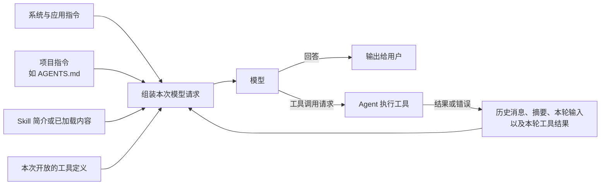

# AI Agent 的输入由什么构成

> 讲解目标：区分“模型实际可见的内容”“工具定义”和“Agent 程序自己管理的状态”。下文描述的是常见 Agent 的逻辑结构；不同产品和 API 的字段名、消息角色及加载方式可能不同。

## 一句话概括

一次 Agent 运行通常包含多次**模型调用**。每次调用前，Agent 程序根据当前任务，组装适用指令、可见上下文、当前开放的工具和调用参数；模型返回回答或工具调用请求。工具执行后，Agent 把结果加入上下文，再调用模型。

## 输入部分及其作用

| 部分 | 主要作用 | 何时进入模型可见范围 |
| --- | --- | --- |
| 系统／开发者指令 | 定义 Agent 的身份、总体规则、任务边界和输出要求。 | 通常在会话或请求开始时由平台、应用提供。 |
| **项目指令，如 `AGENTS.md`** | 定义当前仓库的开发约定、权威文件、构建与测试方法。 | 支持它的编码 Agent 在开始任务前发现适用文件，并加入上下文；它**不是工具定义，也不能直接等同于 API 的 system/developer 角色**。 |
| Skill 元信息 | 告诉模型有哪些可复用的工作流程，以及何时考虑使用。 | 通常先提供名称、描述、路径等简要信息；相关时再读取完整 `SKILL.md` 及所需资源。 |
| 已加载的 Skill 内容 | 给出某类任务的具体步骤、示例和约束。 | Skill 被选择并读取之后，作为后续可见上下文。 |
| 工具定义 | 告诉模型当前能请求哪些操作、用途及参数格式。 | 本次模型调用开放工具时提供；可以来自 Agent 内置工具、应用函数或 MCP 服务。 |
| 之前的上下文 | 保持对话连续性，包含必要的用户消息、模型回答、工具调用及结果。 | 由 Agent 选择历史、摘要或 API 会话状态；不保证每次都包含完整历史。 |
| 本轮用户输入 | 描述当前要完成的任务。 | 每轮用户发出请求后加入。 |
| 本轮工具结果 | 告诉模型刚才执行了什么、成功或失败、得到什么数据。 | Agent 执行工具后加入，再发起下一次模型调用。 |

### `AGENTS.md` 应放在表中的哪一行？

单列为**项目指令**最准确。它在用途上属于“约束 Agent 如何工作”的指令，但在技术实现上不必是系统提示词。OpenAI 的 Codex CLI 公开说明中，发现的 `AGENTS.md` 被注入为带文件来源标记的 **user-role 消息**，放在当前用户请求之前。Codex 会在任务开始时按全局、项目根目录到当前工作目录的路径查找适用文件；修改文件后，启动新任务或会话可确保重新加载。其他 Agent 产品可能采用不同方式。

本仓库的例子：[AGENTS.md](../AGENTS.md) 说明这是课程资料库，并指向课程大纲、讲师草稿和演示素材。它不会自动把 `Outline.md` 全文也加入模型输入；Agent 仍需在分析 `myls` 案例时读取该文件。若在独立练习仓库开发 `myls`，该仓库应另有自己的构建与测试规则。

### “系统工具”和“MCP 工具”要分两栏吗？

可以在**来源**上区分，模型视角下都属于“本次开放的工具定义”：

- Agent 自带或应用实现的工具，例如文件读写、Shell、代码补丁。
- MCP 服务提供的工具，例如外部搜索、数据库查询或业务系统操作。

模型通常看到的是工具名称、说明和参数结构；MCP 连接凭据、权限检查及工具实现由 Agent 或运行环境管理。某个工具安装或连接成功，也不代表每次模型调用都开放给模型。大量工具还可能按需加载。

## 首次调用与工具返回后的再次调用

| 阶段 | 本次调用需要包含的关键信息 | 模型可能返回 |
| --- | --- | --- |
| 本轮首次调用 | 适用指令、Skill 信息、选定的历史、本轮用户输入、开放的工具定义。 | 直接回答，或提出工具调用请求。 |
| 工具执行后再次调用 | 保留必要的任务上下文，加入模型刚提出的工具调用及对应的执行结果或错误。 | 再调用工具，或给出最终答复。 |

例如用户要求“检查 `myls` 的测试为什么失败”，首次调用只知道任务、仓库规则和可用工具。执行测试后，**测试命令、退出码、标准输出和标准错误**才成为后续调用的上下文。仅仅提到某个文件路径，也不等于模型已经看到了该文件内容。

## 两个容易混淆的边界

1. **“给模型看的信息”与“Agent 的运行配置”不同。** 工作目录、工具权限、API 密钥、超时、最大循环次数等通常由程序管理；只有需要模型作判断的部分才会被转化为可见输入。模型可以请求调用工具，但由 Agent 执行和校验。
2. **“逻辑上属于输入”与“API 中叫 `input` 字段”不同。** 工具定义可能放在独立的 `tools` 参数中，指令可能放在 `instructions` 或消息中，历史也可能由会话机制管理。不要把这张逻辑表误当成某个 API 的固定 JSON 结构。

## 讲课时可用的总结

> Agent 的输入不是简单地把所有文件拼成一段提示词。Agent 会在每次模型调用前，按任务选择**指令、上下文和可用工具**；工具返回后再更新上下文。`AGENTS.md` 是预先适用的项目指令，Skill 通常按需展开，工具定义告诉模型“能请求什么”，而实际执行始终由 Agent 负责。

## 参考资料

- [OpenAI Docs：Custom instructions with AGENTS.md](https://learn.chatgpt.com/docs/agent-configuration/agents-md)
- [OpenAI Docs：Codex Prompting Guide — Using agents.md](https://developers.openai.com/cookbook/examples/gpt-5/codex_prompting_guide)
- [OpenAI Docs：Skills](https://developers.openai.com/plugins/concepts/skills)
- [OpenAI Docs：Using tools](https://developers.openai.com/api/docs/guides/tools)
- [OpenAI Docs：Function calling](https://developers.openai.com/api/docs/guides/function-calling)
- [OpenAI Docs：Conversation state](https://developers.openai.com/api/docs/guides/conversation-state)
